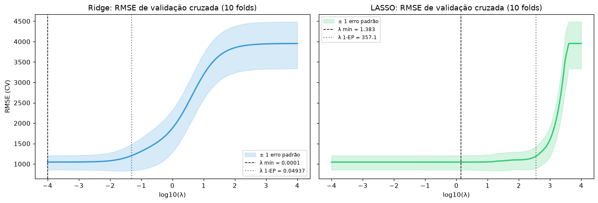
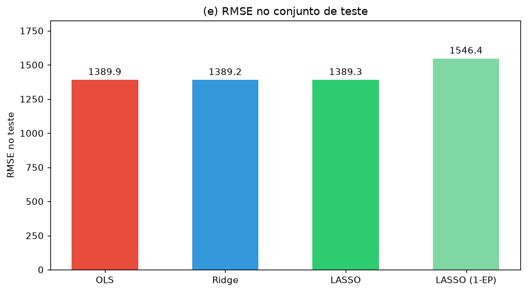
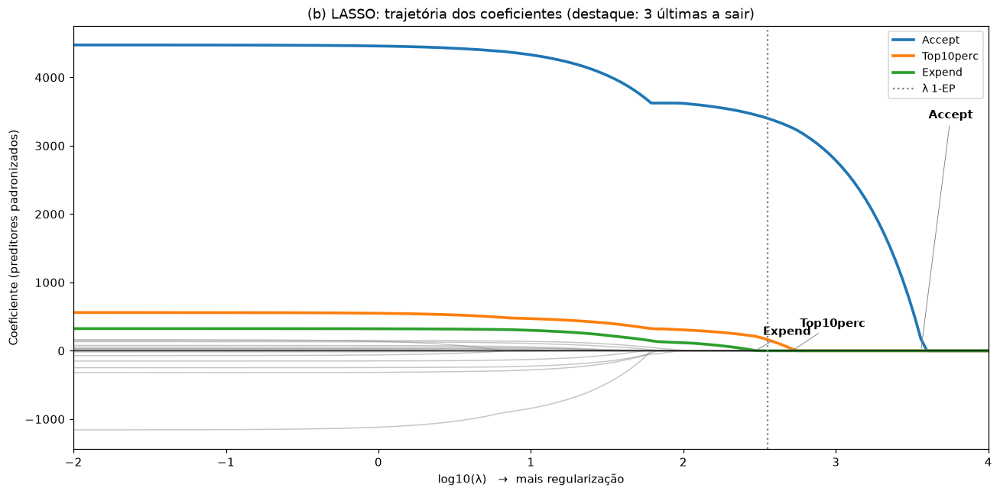
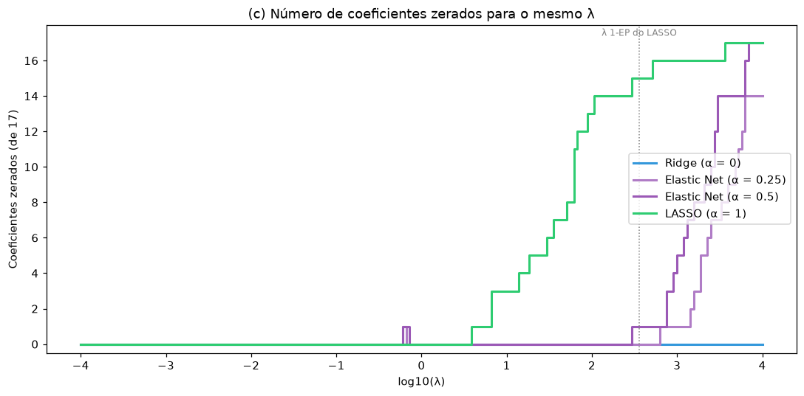
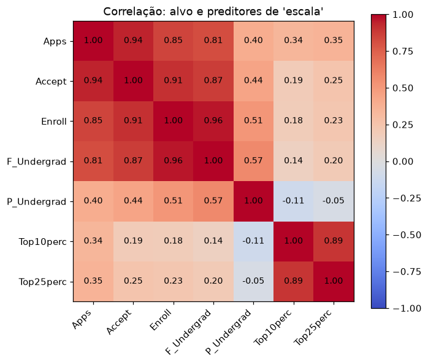
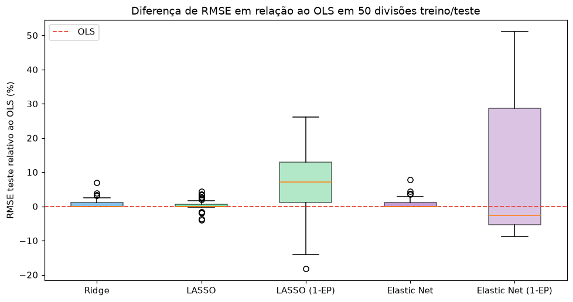

# Métodos de Regularização: Ridge, LASSO e Elastic Net

Previsão do número de inscrições recebidas (`Apps`) por 777 universidades americanas, comparando mínimos quadrados (OLS) com três métodos de regularização. O projeto também investiga quando a regularização ajuda de verdade, como cada método lida com preditores correlacionados e quão estável é a escolha do "melhor" modelo.

## Principais conclusões

1. **Neste problema, a regularização não melhora a previsão de forma consistente.** A validação cruzada escolhe λ praticamente nulo para Ridge e Elastic Net, e um λ pequeno para o LASSO. Em 50 divisões treino/teste diferentes, a diferença mediana de RMSE entre OLS, Ridge, LASSO e Elastic Net é menor que 0,05%.
2. **O ganho está na interpretabilidade.** Um LASSO mais penalizado (regra de 1 erro padrão) usa só `Accept` e `Top10perc` e perde cerca de 7% de RMSE em relação ao modelo completo.
3. **O LASSO escolhe uma variável por grupo correlacionado; o Elastic Net divide o peso.** Com `Accept`, `Enroll` e `F_Undergrad` correlacionados acima de 0,87, o LASSO mantém apenas `Accept`. O Elastic Net mantém as três com coeficientes positivos, o que é mais estável e mais fácil de interpretar.
4. **Comparar Ridge e LASSO "com o mesmo λ" exige converter escalas no scikit-learn.** `Ridge(alpha=λ)` é 543 vezes menos penalizado que `Lasso(alpha=λ)` neste conjunto de treino (ver [docs/elastic_net_penalidade.md](docs/elastic_net_penalidade.md)).

## Estrutura do projeto

```
regularizacao-college/
├── data/
│   └── College.csv                 # base original (777 instituições, 18 variáveis)
├── docs/
│   └── elastic_net_penalidade.md   # Questão 3(a): demonstração algébrica
├── src/
│   ├── config.py                   # caminhos, semente, grade de λ e de α, cores
│   ├── data.py                     # leitura, one-hot de Private, divisão e padronização
│   ├── models.py                   # ajuste com CV, regra 1-EP, conversão de escala do λ
│   ├── q1_ridge_lasso.py           # Questão 1: OLS, Ridge, LASSO
│   ├── q2_elastic_net.py           # Questão 2: Elastic Net α = 0,5 e trajetória do LASSO
│   ├── q3_selecao.py               # Questão 3: grade de α, esparsidade, correlação
│   ├── robustez.py                 # análise complementar com 50 divisões
│   └── utils.py                    # RMSE e funções para salvar resultados
├── tests/
│   └── test_models.py              # equivalências Ridge/LASSO/Elastic Net e preparo dos dados
├── results/
│   ├── figures/                    # gráficos usados neste README
│   └── tables/                     # todas as tabelas em CSV
├── main.py                         # executa tudo
├── requirements.txt
└── README.md
```

O fluxo é linear: `main.py` carrega os dados com `data.py`, cria uma única divisão treino/teste e um único conjunto de folds, e passa os dois para os módulos de cada questão. Assim, todos os modelos são avaliados exatamente nos mesmos dados. Cada módulo imprime os resultados no terminal e salva tabelas e figuras em `results/`.

`models.py` concentra a lógica que se repete entre as questões: ajustar cada modelo com CV, calcular o λ pela regra de 1 erro padrão, detectar quando o λ escolhido cai na borda da grade e converter λ para a escala do `Ridge` do scikit-learn.

## Configuração

O alvo é `Apps`. Os 17 preditores são as demais variáveis, com `Private` convertida em `Private_Yes` (1 = privada). A divisão é 70% treino (543) e 30% teste (234), com semente 42. Os preditores são padronizados com a média e o desvio do treino. A validação cruzada usa 10 folds, os mesmos para todos os modelos.

λ é sempre reportado na escala do glmnet / `ElasticNet`:

$$\frac{1}{2n}\text{RSS} + \lambda\left[\tfrac{1-\alpha}{2}\|\beta\|_2^2 + \alpha\|\beta\|_1\right]$$

A grade de λ vai de 10⁻⁴ a 10⁴ (200 valores). Ela é bem mais ampla que a grade padrão do scikit-learn, porque, nesta base, a grade padrão faz o CV escolher o próprio limite inferior.

---

## Questão 1: OLS, Ridge e LASSO

| Modelo | λ | RMSE CV | RMSE teste | Coef. não nulos |
|---|---|---|---|---|
| OLS | — | — | 1389,9 | 17 |
| Ridge | 0,0001 | 1047,0 | 1389,2 | 17 |
| LASSO | 1,38 | 1046,6 | 1389,3 | 17 |
| LASSO (regra 1-EP) | 357,1 | 1191,2 | 1546,4 | 2 |



As curvas de validação são planas em toda a região de λ pequeno. O Ridge escolhe o menor λ da grade, e o LASSO escolhe λ = 1,38, que não zera nenhum coeficiente. Os três modelos são, na prática, o mesmo modelo, e os RMSEs de teste diferem em menos de 1.

Isso faz sentido para esta base. Com n = 543 e p = 17, o OLS já tem variância baixa, e `Accept` sozinho explica quase toda a variação de `Apps` (r = 0,94). A regularização reduz variância, mas aqui há pouca variância para reduzir.

O RMSE de teste (~1.390) é maior que o de validação cruzada (~1.047) porque `Apps` tem cauda longa (mediana de 1.558, máximo de 48.094). Algumas universidades muito grandes no conjunto de teste pesam bastante no RMSE.

**(e) Qual método teve menor erro?** Nesta divisão, o Ridge, por 0,65 de RMSE (0,05%). A análise de robustez mostra que essa diferença é ruído: nenhum dos três é consistentemente melhor.



## Questão 2: Elastic Net e trajetória do LASSO

**(a) Elastic Net com α = 0,5.** A CV escolhe λ = 0,0001, o mínimo da grade, e o RMSE de teste fica em 1389,6. O resultado é o mesmo do OLS, Ridge e LASSO, pelo mesmo motivo: a CV prefere não penalizar.

**(b) Trajetória dos coeficientes do LASSO.**



À medida que λ aumenta, as três variáveis que permanecem por mais tempo no modelo são:

| Variável | Maior λ em que ainda é não nula |
|---|---|
| `Accept` | 3.612 |
| `Top10perc` | 517 |
| `Expend` | 297 |

`Accept` domina porque é quase uma medida direta da escala do processo seletivo. `Top10perc` (prestígio acadêmico) e `Expend` (gasto por aluno) trazem informação que `Accept` não contém.

**(c) Qual modelo escolher?** Depende do objetivo:

- **Para previsão**, qualquer um dos modelos completos serve, porque são equivalentes. **LASSO com λ da CV**, empata no erro e tem a vantagem de poder simplificar o modelo se os dados mudarem.
- **Para explicar**, o **LASSO com regra 1-EP** usa só 2 variáveis e custa ~7% de RMSE na mediana das 50 divisões.

A escolha original do Ridge, baseada em 0,05% de diferença numa única divisão, não se sustenta.

## Questão 3: penalização e seleção de variáveis

**(a) Ridge e LASSO como casos especiais.** A demonstração está em [docs/elastic_net_penalidade.md](docs/elastic_net_penalidade.md). O mesmo documento explica a diferença de escala entre `Ridge` e `ElasticNet` no scikit-learn.

**(b) CV conjunta em α e λ.**

| α | λ ótimo | RMSE CV |
|---|---|---|
| 0 (Ridge) | 0,0001 | 1047,02 |
| 0,1 | 0,0001 | 1046,97 |
| 0,25 | 0,0001 | 1046,94 |
| 0,5 | 0,0001 | 1046,88 |
| 0,75 | 0,0001 | 1046,82 |
| 0,9 | 0,0001 | 1046,79 |
| **1 (LASSO)** | **1,38** | **1046,64** |

O melhor é α = 1 com λ = 1,38. O modelo "Elastic Net final" é, na verdade, um LASSO pouco penalizado. As diferenças de RMSE entre os valores de α estão na segunda casa decimal, o que confirma que a escolha de α é quase indiferente aqui.

**(c) Coeficientes zerados com o mesmo λ.**

| Modelo | λ = 1,38 (ótimo da CV) | λ = 357 (1-EP do LASSO) |
|---|---|---|
| Ridge (α = 0) | 0 | 0 |
| Elastic Net (α = 0,5) | 0 | 1 |
| LASSO (α = 1) | 0 | 15 |



O Ridge nunca zera coeficientes: a penalidade quadrática encolhe todos, mas nenhum chega a exatamente zero. Qualquer α > 0 introduz a parte L₁, que zera o coeficiente βⱼ quando λα supera a correlação de xⱼ com o resíduo dos demais preditores.

Para o mesmo λ, quanto maior o α, mais zeros. O Elastic Net zera mais que o Ridge sempre que α > 0 e λ é grande o suficiente. No gráfico, isso começa em λ ≈ 300 para α = 0,5, e em λ ≈ 4 para o LASSO.

**(d) Os três maiores coeficientes do modelo final** (preditores padronizados, ou seja, efeito de 1 desvio padrão):

| Variável | Coeficiente |
|---|---|
| `Accept` | +4.454 |
| `Enroll` | −1.105 |
| `Top10perc` | +544 |

- **`Accept` (candidatos aceitos)** mede a escala do processo seletivo. Universidades que aceitam mais candidatos são, em geral, as que recebem mais inscrições.
- **`Top10perc` (% de calouros entre os 10% melhores do ensino médio)** mede o prestígio acadêmico. Instituições mais seletivas atraem mais candidatos, inclusive muitos que não serão aceitos.
- **`Enroll` (matriculados) tem coeficiente negativo**, apesar de ter correlação +0,85 com `Apps`. O sinal é um efeito parcial: para o mesmo número de aceitos, mais matrículas significam maior taxa de conversão de aceitos em matriculados. Isso tende a ocorrer em instituições com demanda mais "cativa", que recebem menos inscrições de quem se candidata a várias faculdades como garantia. Esse sinal, porém, não é robusto: `Enroll` tem correlação 0,91 com `Accept` e 0,96 com `F_Undergrad`. Com um pouco mais de penalização L₂, ele vira positivo (Elastic Net 1-EP: +11), e o LASSO 1-EP o zera. Ele deve ser lido como um ajuste fino sobre `Accept`, e não como "mais matrículas reduzem inscrições".

**(e) Com p ≪ n, o Elastic Net não oferece vantagem sobre o LASSO?** Discordo em parte. O argumento vale para a **qualidade da previsão**: nesta base, todos os modelos empatam. Mas p ≪ n não elimina o problema dos **preditores correlacionados**, e é aí que o Elastic Net se diferencia.



Há cinco pares de preditores com |r| > 0,8: `Enroll`–`F_Undergrad` (0,97), `Accept`–`Enroll` (0,91), `Top10perc`–`Top25perc` (0,89), `Accept`–`F_Undergrad` (0,87) e `PhD`–`Terminal` (0,85). Comparando os dois métodos, cada um com seu λ pela regra 1-EP:

| Variável | OLS | LASSO 1-EP | Elastic Net α=0,5 1-EP |
|---|---|---|---|
| `Accept` | 4.475 | 3.401 | 3.229 |
| `Enroll` | −1.158 | 0 | 11 |
| `F_Undergrad` | 163 | 0 | 190 |
| `Top10perc` | 560 | 162 | 352 |
| `Top25perc` | −71 | 0 | 68 |

- O **OLS** dá sinais opostos a variáveis quase colineares (`Enroll` negativo, `F_Undergrad` positivo; `Top10perc` positivo, `Top25perc` negativo). É o sintoma clássico de multicolinearidade.
- O **LASSO** resolve escolhendo um representante por grupo e zerando os outros. Em 200 reamostragens bootstrap, `Top10perc` é escolhida em 90% das vezes e `Top25perc` em 3%. `Enroll` e `F_Undergrad` quase nunca entram (2% e 6%). A escolha funciona, mas descarta informação, e o representante escolhido pode mudar com os dados.
- O **Elastic Net** mantém o grupo, com coeficientes de mesmo sinal e magnitudes coerentes com as correlações. É o *efeito de agrupamento* da penalidade L₂. Nesta divisão, o Elastic Net 1-EP teve RMSE de teste de 1272,9, contra 1546,4 do LASSO 1-EP.

Ou seja, a vantagem do Elastic Net depende da estrutura de correlação, e não só da razão p/n. Quando o objetivo é um modelo enxuto e estável, essa estrutura importa mesmo com n grande.

## Análise complementar: robustez em 50 divisões

Uma única divisão treino/teste pode favorecer um modelo por acaso. Por isso, o processo inteiro (divisão, padronização, CV e avaliação) foi repetido com 50 sementes.

| Modelo | RMSE médio | Diferença mediana vs OLS | Melhor que OLS em |
|---|---|---|---|
| OLS | 1.152 | — | — |
| Ridge | 1.162 | −0,02% | 68% das divisões |
| LASSO | 1.157 | 0,00% | 62% |
| Elastic Net (α=0,5) | 1.163 | −0,01% | 68% |
| LASSO (1-EP) | 1.229 | +7,2% | 22% |
| Elastic Net (1-EP) | 1.263 | −2,7% | 62% |



- Ridge, LASSO e Elastic Net com λ da CV são indistinguíveis do OLS. Eles ganham em cerca de 2/3 das divisões, mas por margens desprezíveis, e perdem por pouco mais em algumas, o que deixa a média levemente pior.
- O Elastic Net 1-EP tem o comportamento mais interessante. Na mediana, é 2,7% melhor que o OLS, e foi o melhor modelo em metade das divisões. Mas sua variabilidade é a maior de todas (desvio padrão de 390), com algumas divisões muito ruins. Isso provavelmente reflete a cauda longa de `Apps`: um modelo mais encolhido erra mais nas poucas universidades gigantes.
- O LASSO 1-EP é consistentemente pior (+7%), que é o preço de usar só 2 ou 3 variáveis.

## Próximos passos

- Modelar `log(Apps)`, que reduz a influência das universidades gigantes e deve diminuir bastante o erro relativo.
- Escolher α e λ com CV aninhada, para estimar o erro sem viés de seleção.

## Ferramentas

Python, scikit-learn, pandas, NumPy, Matplotlib e pytest.
